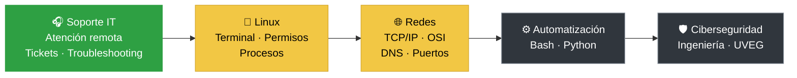

# Diego Rocha

### Soporte Técnico · Helpdesk L1

Técnico de soporte con experiencia en atención remota a usuarios y resolución de incidencias. 
Documento aquí mi aprendizaje en <b>Linux</b>, <b>redes</b> y <b>ciberseguridad</b>.

---

## 📂 Proyectos

| Proyecto | Descripción | Estado |
|---|---|:---:|
| 🛠️ [**rochamx-helpdesk**](https://github.com/rocha-d/rochamx-helpdesk) | Casos de soporte documentados: diagnóstico, solución y aprendizaje |  |
| 🐧 [**Linux-lab-setup**](https://github.com/rocha-d/Linux-lab-setup) | Práctica de fundamentos de Linux en un laboratorio personal |  |

## 🗺️ Roadmap

🟩 Completado · 🟨 En curso · ⬛ Próximo

## 🛠️ Herramientas

## 📫 Contacto

